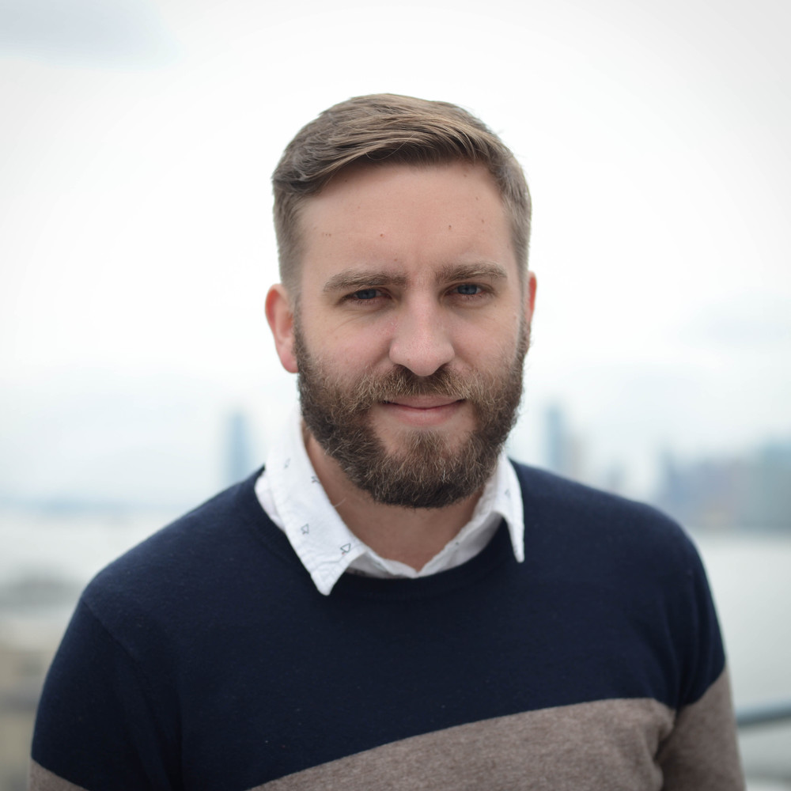
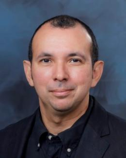

Workshop Schedule
+++++++++++++++++

.. |SC26Sched| raw:: html

   <a href="https://sc26.conference-program.com/session/?sess=sess124" target="_blank">Link to SC25 HPPSS Schedule</a>

HPPSS will take place on Monday, November 15th from 2 PM - 5:30 PM CST in room W183b. See the |SC26Sched| for more details.

+-----------------------------------------------------------+-------------------------------------------------------------+---------------------+
| Event                                                     | Speaker(s)                                                  | Time                |
+===========================================================+=============================================================+=====================+
| HPPSS Introduction                                        | Pete Mendygral, Sunita Chandrasekaran, Daniel Margala,      | 2 PM - 2:05 PM      |
|                                                           |                                                             |                     |
|                                                           | Sam Foreman, Davin Potts, Andy Terrel                       |                     |
+-----------------------------------------------------------+-------------------------------------------------------------+---------------------+
| Featured Speaker                                          | Ryan Abernathey                                             | 2:05 PM - 2:45 PM   |
+-----------------------------------------------------------+-------------------------------------------------------------+---------------------+
| AI for Science with Python on AMD Supercomputers          | Giacomo Capodaglio, Nicholas Malaya, Jose Noudohouenou,     | 2:45 PM - 3 PM      |
|                                                           |                                                             |                     |
|                                                           | Sidafa Conde, Alessandro Fanfarillo, Jonathan Belof         |                     |
+-----------------------------------------------------------+-------------------------------------------------------------+---------------------+
| Afternoon Break                                           |                                                             | 3 PM - 3:30 PM      |
+-----------------------------------------------------------+-------------------------------------------------------------+---------------------+
| sundials4py: state-of-the-art time integrators for        | Cody Balos, David Gardner, Steven Roberts, Daniel Reynolds, | 3:30 PM - 3:45 PM   |
|                                                           |                                                             |                     |
| high-performance Python                                   | Carol Woodward                                              |                     |
+-----------------------------------------------------------+-------------------------------------------------------------+---------------------+
| Invited Speaker: Python as the Connective Tissue of the   | Rafael Ferreira da Silva                                    | 3:45 PM - 4:15 PM   |
|                                                           |                                                             |                     |
| Genesis Mission: From Exascale Workflows to Federated     |                                                             |                     |
|                                                           |                                                             |                     |
| Scientific Agents                                         |                                                             |                     |
+-----------------------------------------------------------+-------------------------------------------------------------+---------------------+
| A Distributed HPC/AI Services Ecosystem for the Genesis   | Aymen Alsaadi, Andre Merzky, Andrew Shao, Shantenu Jha      | 4:15 PM - 4:30 PM   |
|                                                           |                                                             |                     |
| Mission Platform                                          |                                                             |                     |
+-----------------------------------------------------------+-------------------------------------------------------------+---------------------+
| Python-Based Distributed Training on AMD GPU              | Vijeta Sharma                                               | 4:30 PM - 4:45 PM   |
|                                                           |                                                             |                     |
| Supercomputers: Lessons from Data, Pipeline, and Tensor   |                                                             |                     |
|                                                           |                                                             |                     |
| Parallelism on LUMI                                       |                                                             |                     |
+-----------------------------------------------------------+-------------------------------------------------------------+---------------------+
| Panel Discussion: Beyond FLOPS and Kernels: Benchmarking  | Michela Taufer, Glenn Lockwood, Rollin Thomas, Minjia Zhang | 4:45 PM - 5:30 PM   |
|                                                           |                                                             |                     |
| Agentic Science and the Future Role of Python             |                                                             |                     | 
+-----------------------------------------------------------+-------------------------------------------------------------+---------------------+

Ryan Abernathey (Earthmover) - Featured Speaker
===============================================

Ryan P. Abernathey is a scientist, startup founder, and open-source software developer. He is the CEO and co-founder of Earthmover PBC, a startup on a mission to empower people to use scientific data to solve humanity's greatest challenges. Until 2024, he was an Associate Professor of Earth And Environmental Science at Columbia University and Lamont Doherty Earth Observatory. As a physical oceanographer, he has studied the large-scale ocean circulation and its relationship with Earth's climate using climate models and satellite data. He received his Ph.D. from MIT in 2012 and did a postdoc at Scripps Institution of Oceanography. He has received an Alfred P. Sloan Research Fellowship in Ocean Sciences, an NSF CAREER award, The Oceanography Society Early Career Award, and the AGU Falkenberg Award. He was a member of the NASA Surface Water and Ocean Topography (SWOT) science team and Director of Data and Computing for a new NSF Science and Technology Center called Learning the Earth with Artificial Intelligence and Physics (LEAP). Dr. Abernathey is an active participant in and advocate for open source software, open data, and reproducible science. In 2016 he helped found the Pangeo project, an open science community focused on big scientific data analytics.

|

|

Rafael Ferreira Da Silva (ORNL) - Invited Speaker
=================================================

.. |RDS| raw:: html

   <a href="https://rafaelsilva.com" target="_blank">https://rafaelsilva.com</a>

Rafael Ferreira da Silva is a Distinguished Research Scientist and the Section Head for Data and AI Systems (DAIS) section in the Computer Science and Mathematics division (CSMD), leading research and development in AI, data and agentic workflows, and advanced computing systems. Dr. Ferreira da Silva's research focuses on workflow benchmarking on distributed computing platforms, hybrid quantum-classical workflows, and autonomous laboratory systems. He has extensive experience leading/working on large-scale projects related to distributed computing platforms, cyberinfrastructure systems, and applications. Notably, he is a co-founder and the Executive Director of the Workflows Community Initiative. He also brings substantial experience on community engagement and workshop organization. He was PI on a number of DOE- and NSF-funded projects, and his scholarly work includes more than 160 peer-reviewed journal articles, conference proceedings articles, book chapters, editorials, and conference abstracts. His achievements and expertise are further highlighted by his status as a Senior Member of the IEEE and ACM. For more information about his work and contributions, please visit |RDS| .
