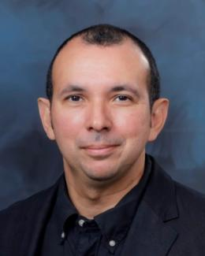

Workshop Schedule
+++++++++++++++++

.. |SC26Sched| raw:: html

   <a href="https://sc26.conference-program.com/session/?sess=sess124" target="_blank">Link to SC26 HPPSS Schedule</a>

HPPSS will take place on Sunday, November 15th from 2 PM - 5:30 PM CST in room W183b. See the |SC26Sched| for more details.

+-----------------------------------------------------------+-------------------------------------------------------------+---------------------+
| Event                                                     | Speaker(s)                                                  | Time                |
+===========================================================+=============================================================+=====================+
| HPPSS Introduction                                        | Pete Mendygral, Sunita Chandrasekaran, Daniel Margala,      | 2 PM - 2:05 PM      |
|                                                           |                                                             |                     |
|                                                           | Sam Foreman, Davin Potts, Andy Terrel                       |                     |
+-----------------------------------------------------------+-------------------------------------------------------------+---------------------+
| Featured Speaker                                          | Ryan Abernathey                                             | 2:05 PM - 2:45 PM   |
+-----------------------------------------------------------+-------------------------------------------------------------+---------------------+
| AI for Science with Python on AMD Supercomputers          | Giacomo Capodaglio, Nicholas Malaya, Jose Noudohouenou,     | 2:45 PM - 3 PM      |
|                                                           |                                                             |                     |
|                                                           | Sidafa Conde, Alessandro Fanfarillo, Jonathan Belof         |                     |
+-----------------------------------------------------------+-------------------------------------------------------------+---------------------+
| Afternoon Break                                           |                                                             | 3 PM - 3:30 PM      |
+-----------------------------------------------------------+-------------------------------------------------------------+---------------------+
| sundials4py: state-of-the-art time integrators for        | Cody Balos, David Gardner, Steven Roberts, Daniel Reynolds, | 3:30 PM - 3:45 PM   |
|                                                           |                                                             |                     |
| high-performance Python                                   | Carol Woodward                                              |                     |
+-----------------------------------------------------------+-------------------------------------------------------------+---------------------+
| Invited Speaker: Python as the Connective Tissue of the   | Rafael Ferreira da Silva                                    | 3:45 PM - 4:15 PM   |
|                                                           |                                                             |                     |
| Genesis Mission: From Exascale Workflows to Federated     |                                                             |                     |
|                                                           |                                                             |                     |
| Scientific Agents                                         |                                                             |                     |
+-----------------------------------------------------------+-------------------------------------------------------------+---------------------+
| A Distributed HPC/AI Services Ecosystem for the Genesis   | Aymen Alsaadi, Andre Merzky, Andrew Shao, Shantenu Jha      | 4:15 PM - 4:30 PM   |
|                                                           |                                                             |                     |
| Mission Platform                                          |                                                             |                     |
+-----------------------------------------------------------+-------------------------------------------------------------+---------------------+
| Python-Based Distributed Training on AMD GPU              | Vijeta Sharma                                               | 4:30 PM - 4:45 PM   |
|                                                           |                                                             |                     |
| Supercomputers: Lessons from Data, Pipeline, and Tensor   |                                                             |                     |
|                                                           |                                                             |                     |
| Parallelism on LUMI                                       |                                                             |                     |
+-----------------------------------------------------------+-------------------------------------------------------------+---------------------+
| Panel Discussion: Beyond FLOPS and Kernels: Benchmarking  | Michela Taufer, Glenn Lockwood, Rollin Thomas, Minjia Zhang | 4:45 PM - 5:30 PM   |
|                                                           |                                                             |                     |
| Agentic Science and the Future Role of Python             |                                                             |                     | 
+-----------------------------------------------------------+-------------------------------------------------------------+---------------------+

Ryan Abernathey (Earthmover) - Featured Speaker
===============================================

Ryan P. Abernathey is a scientist, startup founder, and open-source software developer. He is the CEO and co-founder of Earthmover PBC, a startup on a mission to empower people to use scientific data to solve humanity's greatest challenges. Until 2024, he was an Associate Professor of Earth And Environmental Science at Columbia University and Lamont Doherty Earth Observatory. As a physical oceanographer, he has studied the large-scale ocean circulation and its relationship with Earth's climate using climate models and satellite data. He received his Ph.D. from MIT in 2012 and did a postdoc at Scripps Institution of Oceanography. He has received an Alfred P. Sloan Research Fellowship in Ocean Sciences, an NSF CAREER award, The Oceanography Society Early Career Award, and the AGU Falkenberg Award. He was a member of the NASA Surface Water and Ocean Topography (SWOT) science team and Director of Data and Computing for a new NSF Science and Technology Center called Learning the Earth with Artificial Intelligence and Physics (LEAP). Dr. Abernathey is an active participant in and advocate for open source software, open data, and reproducible science. In 2016 he helped found the Pangeo project, an open science community focused on big scientific data analytics.

Presentation
------------

**Making Science Faster: Knowledge Creation Infrastructure for the AI Era**

Today, AI is poised to radically accelerate science. But it can only do so effectively if we have a clear understanding of the actual limitations on scientific progress. I’ve spent my career in the trenches with data-intensive science as a computational oceanographer, professor and group leader, and developer of scientific software. I’ve formed strong opinions on this topic.

Science can be modeled as a graph. The nodes are specific discoveries. The edges are connections to previous discoveries, building on prior knowledge. A modern scientific discovery typically builds on a few things:

   - Prior knowledge, which today is typically encoded as natural language (e.g. in a paper)
   - Computer code 
   - Existing data

It adds some new knowledge, and maybe produces some new code and / or data. And the process repeats.

The rate of advancement (adding new nodes to the graph) is constrained by two things:

   1. How fast an individual project can be executed (reasoning and data processing speed)
   2. How fast knowledge can propagate through the network (how easily and openly we can share knowledge, code, and data)

The main rate limiter has long been the reasoning capacity in 1. Thinking just takes time! But that is changing quickly. We now have AI that can reason, write code, and interpret data incredibly fast.

That leaves infrastructure as the remaining bottleneck. It’s no coincidence that the biggest AI-driven scientific breakthroughs to date have been in mathematics—on topics that require pure reasoning (and very little data and computation).

In this talk, I will describe our ongoing work at Earthmover to remove bottlenecks in data-intensive science for both humans and agents.

Accelerating an individual project (1) comes down to rethinking how scientific data are stored and processed. On this front, I’ll describe the Icechunk tensor storage engine, which makes it easier to create fast, AI-ready datasets from legacy file archives, and the Zax project, a new Rust-based tensor compute engine for large-scale scientific data processing.

Accelerating knowledge propagation (2) is essentially the dream of the open science movement. On this front, I’ll talk about the promise of analysis-ready, cloud-optimized (ARCO) data, and our progress so far in building an enterprise-grade multi-cloud ARCO data commons—the Earthmover data marketplace, which now contains over 160 PB of ARCO weather, climate, and geospatial data from over 20 different providers. ARCO data repositories such as this allow instant, high-performance data access, bypassing time consuming download workflows.

I’ll conclude with a reflection on the evolving role of humans in this new agentic science landscape.

Rafael Ferreira Da Silva (ORNL) - Invited Speaker
=================================================

.. |RDS| raw:: html

   <a href="https://rafaelsilva.com" target="_blank">https://rafaelsilva.com</a>

Rafael Ferreira da Silva is a Distinguished Research Scientist and the Section Head for Data and AI Systems (DAIS) section in the Computer Science and Mathematics division (CSMD), leading research and development in AI, data and agentic workflows, and advanced computing systems. Dr. Ferreira da Silva's research focuses on workflow benchmarking on distributed computing platforms, hybrid quantum-classical workflows, and autonomous laboratory systems. He has extensive experience leading/working on large-scale projects related to distributed computing platforms, cyberinfrastructure systems, and applications. Notably, he is a co-founder and the Executive Director of the Workflows Community Initiative. He also brings substantial experience on community engagement and workshop organization. He was PI on a number of DOE- and NSF-funded projects, and his scholarly work includes more than 160 peer-reviewed journal articles, conference proceedings articles, book chapters, editorials, and conference abstracts. His achievements and expertise are further highlighted by his status as a Senior Member of the IEEE and ACM. For more information about his work and contributions, please visit |RDS| .

Presentation
------------

**Python as the Connective Tissue of the Genesis Mission: From Exascale Workflows to Federated Scientific Agents**

The DOE Genesis Mission aims to couple AI, exascale computing, experimental facilities, and autonomous laboratories into an integrated discovery platform, and much of what holds that platform together is written in Python. Large-scale simulation campaigns, AI training and inference pipelines, workflow orchestration, provenance capture, and multi-agent systems all converge on a shared Python layer that lets scientists compose resources across institutional and facility boundaries. Drawing on experience designing agentic systems for scientific resource discovery and workflow composition, performance studies of workflow execution on leadership-class machines, and a decade of community building around scientific workflows, this talk examines where Python succeeds as the orchestration fabric for AI-coupled science and where it strains, from startup and coordination overheads at scale to environment portability across facilities, concurrency, and the cost of provenance and governance in autonomous loops.

